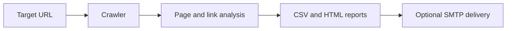

# Technical case study: SEO Auditor

## Problem
Manual technical SEO reviews are repetitive and difficult to compare across pages.

## Approach
A Python CLI recursively crawls internal links, captures page status and timing, checks metadata and image alt attributes, identifies duplicate metadata and broken links, and produces CSV and HTML reports. Docker provides a documented execution option.



## Reproduction
Use an authorized test site with known metadata and broken links.

```sh
python3 -m venv venv
source venv/bin/activate
pip install -r requirements.txt
python -m seo_auditor.cli https://example.com
```

## Evidence
[README](README.md) documents CLI and Docker usage. [Testing](TESTING.md) describes verification and dependency auditing.

## Limitations
A passing dependency audit is not a functional crawler test. No measured SEO ranking improvement, crawl throughput or comprehensive accuracy benchmark is claimed. Keep SMTP credentials out of Git.

## Resume summary
Developed a Python technical SEO crawler with automated metadata checks, structured reporting and containerized execution.
