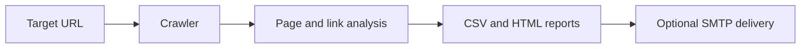
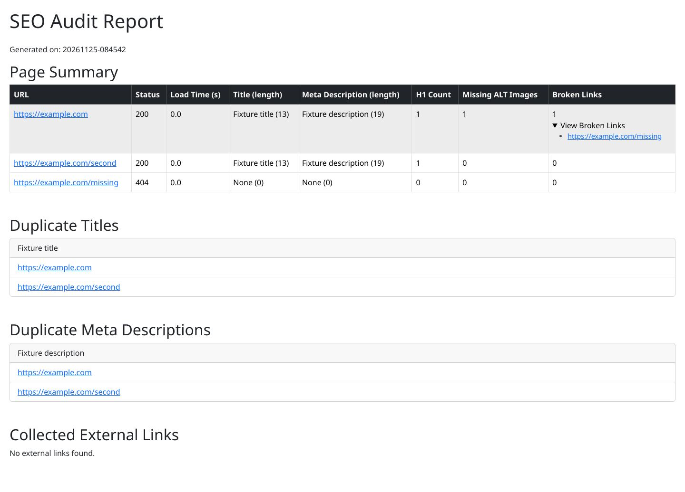

# Technical case study: SEO Auditor

## Problem
Manual technical SEO reviews are repetitive and difficult to compare across pages.

## Approach
A Python CLI recursively crawls internal links, captures page status and timing, checks metadata and image alt attributes, identifies duplicate metadata and broken links, and produces CSV and HTML reports. Docker provides a documented execution option.



## Reproduction
Use an authorized test site with known metadata and broken links.

```sh
python3 -m venv venv
source venv/bin/activate
pip install -r requirements.txt
python -m seo_auditor.cli https://example.com
```

## Evidence
[README](README.md) documents CLI and Docker usage. [Testing](TESTING.md) describes verification and dependency auditing.

## Limitations
A passing dependency audit is not a functional crawler test. No measured SEO ranking improvement, crawl throughput or comprehensive accuracy benchmark is claimed. Keep SMTP credentials out of Git.

## Reproducible fixture demonstration

Run the offline fixture suite from the repository root after installing the requirements above.

```sh
python -m unittest discover -s tests -v
```

Two synthetic pages share a title and meta description, and the home page links to a missing page. The fixture expects statuses 200, 200 and 404, one image missing alt text on the home page, and the missing URL listed as a broken link. Both report formats should be produced, with three data rows in CSV and the fixture title visible in HTML.

## Example report

The screenshot shows the HTML generated from the offline fixture above. The crawler recorded two successful pages, a 404, duplicate metadata, and a broken link. The CSV and HTML were generated at revision `5a9d1b23c957` on Python 3.12 with locally resolved dependencies. All five fixture tests passed on that local run. The screenshot was captured in Chromium.



## Resume summary
Developed a Python technical SEO crawler with automated metadata checks, structured reporting and containerized execution.

## Verified CI evidence — 2026-11-25

Five offline functional tests passed on Python 3.11, covering crawl status, metadata and images, broken links, duplicate detection, and CSV and HTML reports. The previous run exposed a report-rendering failure when a non-200 response had no broken-link list. The fix preserves the CSV field and skips the HTML details block for an absent or empty list. In the passing run, pip-audit reported no known vulnerabilities in the pinned requirements.

- [Passing GitHub Actions run](https://github.com/robbiecalvin/seo-auditor/actions/runs/45644423442)
- [Tested revision](https://github.com/robbiecalvin/seo-auditor/commit/32924d352ccc5cd1980beed1eacf95232839e06b)
- [Original failing run](https://github.com/robbiecalvin/seo-auditor/actions/runs/45643587873)
